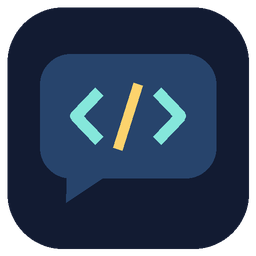
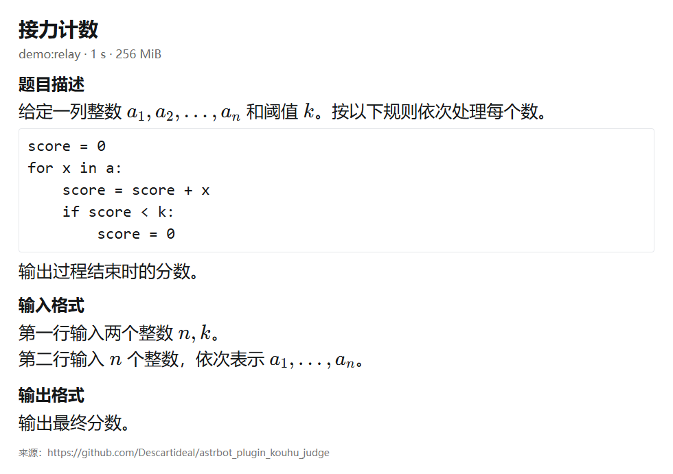

# 口胡判题 · AstrBot

**在 QQ 群里开一轮算法题。读题、讲思路、抢首杀。**

[快速开始](#快速开始) · [常用指令](#常用指令) · [配置与数据](#配置与数据) · [报告问题](https://github.com/Descartideal/astrbot_plugin_kouhu_judge/issues)

“这题我会，维护一个前缀和就行。”群友写下这个思路后，机器人会核对适用条件、关键步骤和复杂度，指出卡住的地方。第一位通过的玩家拿下首杀，其他人可以继续练习。一个人也能在私聊里刷题。

| 体验 | 能做什么 |
| --- | --- |
| 📖 在手机上读题 | Codeforces 和 AtCoder 题面生成中文图，样例单独排版。公式、伪代码和缩进保留。需要时用 `/cue` 查看可用的英文原文。 |
| 💬 用自己的话提交 | `/submit` 接受算法思路或代码，返回 AC、WA 或需要补充的信息。普通提交遇到分歧后，可配置轻度思考复判。 |
| 🏁 和群友抢首杀 | 每群独立回合、积分和排行榜，支持按难度抽题以及结束后的练习补交。 |
| ⚡ 提前备好下一题 | 已缓存的题目从本地 SQLite 抽取，群聊可以预备下一题。题源暂时不可达时，已有题库仍可抽取。 |

展开查看题面演示

演示图由插件渲染原创示例生成。

## 快速开始

1. 使用 AstrBot **4.28.1 或更新版本**、Python **3.11+** 和已接入的 **OneBot v11**。在 AstrBot 管理面板的插件页选择从仓库安装，填入本仓库地址。也可以上传 [Release 安装包](https://github.com/Descartideal/astrbot_plugin_kouhu_judge/releases)。
2. 在 AstrBot 的 Python 环境安装插件依赖 `python -m pip install -r requirements.txt`。Windows 已装 Edge 时，在插件配置设置 `browser_channel=msedge`。Linux 或容器中可执行 `python -m playwright install --with-deps chromium`，并安装中文字体，例如 `fonts-noto-cjk`。容器内执行这些步骤时，浏览器和字体需对 AstrBot 运行用户可用。
3. 先用私聊试用，发送 `/kh help`。要在 QQ 群开启，再往 `enabled_groups` 加入完整的会话标识，如 `你的平台ID:GroupMessage:10001`。群会话仍需通过 AstrBot 自身的会话过滤。
4. 新安装的题库从空开始。默认会在空闲时补库。管理员可发送 `/kh sync cf 1400-1800 15` 尝试立即补充，或用 `/kh sync at 1200-1800 15` 搜集 AtCoder 题。用 `/bankstatus` 查看入库数量，有题后发送 `/new`。

## 常用指令

| 指令 | 用法 |
| --- | --- |
| `/new` | 按房间默认设置开题，初始默认 CF 1400–1800。 |
| `/new cf 1500` · `/new at 1200-1800` | 指定平台和难度。单数字按 ±50 选题，AtCoder 使用插件换算难度。 |
| `/cur` · `/cue` | 查看当前中文题面或可用的英文原版，两者都有样例。 |
| `/submit 做法` | 提交本题思路或代码。 |
| `/submit heavy [修订做法]` | 普通提交得到 WA 或 UNCERTAIN 后，使用支持推理参数的独立接口复判。省略做法会复判最近一次失败。 |
| `/late 题号 做法` | 补交本房间已经结束的题，记为练习。 |
| `/ranklist` · `/giveup` | 查看群榜或结束当前回合。 |
| `/kh help` | 查看完整命令与管理员用法。 |

## 配置与数据

- **模型。** 普通判题可复用 AstrBot 的会话模型，或用 `judge_provider` 指定提供商。独立 OpenAI 兼容接口使用 `api_base_url`、`api_model` 和 `api_key`，请在 WebUI 填写。翻译优先使用显式 `translation_provider`，也可以使用已配置的独立接口或当前会话模型。关闭 `translate` 可直接渲染题源文本。
- **请求。** 首次中文题面和后台预备可能调用翻译模型，命中缓存时直接复用。翻译请求包含题面文本，判题请求包含题面、题解依据和该玩家与本题相关的提交。模型会偶尔误判，正式评测请以竞赛评测机为准。
- **题库。** 本地 SQLite 保存题库、回合、提交和积分，浏览器图片和译文缓存也保存在插件数据目录。后台补库只接收满足来源和完整性检查的题目，支持在设置里关闭。详见 [题源与署名](SOURCE-ATTRIBUTION.md)。
- **排错。** 提示题库为空时先查 `/bankstatus`，确认目标难度已有题。图片失败时检查浏览器和字体。判题失败时核对模型名称、权限及接口连通性。提交 Issue 时请去掉 Key、群号、聊天记录和完整日志。

## 许可

插件原创代码采用 [MIT](LICENSE)。内置 KaTeX 保留[原许可](static/katex/LICENSE)。运行时获取的竞赛题面、样例和题解归各自权利人，见[题源说明](SOURCE-ATTRIBUTION.md)。
